 

**Building modern, responsive web experiences where clean engineering meets thoughtful design.**

 

 

## 👋 About Me

I'm an undergraduate in **Multimedia and Web Technology** with a focus on front-end development and UI/UX design. I enjoy turning ideas into polished, user-friendly web applications, and I'm continuously strengthening my programming and design skills through hands-on projects.

| | |
|:---|:---|
| 🎓 **Education** | Undergraduate, Multimedia and Web Technology |
| 💻 **Focus Areas** | Web Development · UI/UX Design · Multimedia Design |
| 🌱 **Currently** | Improving full-stack development skills |
| 🚀 **Building** | Portfolio projects and modern web applications |
| 📍 **Based in** | Sri Lanka 🇱🇰 |

## 🎯 What I Do

| 🌐 **Web Development** | 🎨 **UI/UX Design** | 🎬 **Multimedia Design** |
|:---:|:---:|:---:|
| Responsive websites and interactive web applications | Clean, user-friendly interfaces and layouts | Creative visuals and digital media for the web |

## 🛠️ Tech Stack

| Category | Technologies |
|:---|:---|
| **Frontend** |  |
| **Backend & Database** |  |
| **Design & Tools** |  |

## 🌟 Featured Project

### 🌍 Ceylon Explore

A responsive, database-driven travel platform that showcases the destinations and travel experiences of Sri Lanka.

| | |
|:---|:---|
| **Role** | Design & Full-Stack Development |
| **Highlights** | Responsive UI · Destination showcase · Interactive features · Database integration |
| **Stack** | `HTML` `CSS` `JavaScript` `PHP` `MySQL` |

## 📊 GitHub Stats

## 🤝 Let's Connect

I'm always open to collaborating on interesting projects and learning from the developer community.

- 💼 **LinkedIn:** [praveen-manahara](https://www.linkedin.com/in/praveen-manahara-b39826450/)
- 📧 **Email:** [praveenmanahara7@gmail.com](mailto:praveenmanahara7@gmail.com)
- 🌐 **Portfolio:** Coming soon

 

*“To combine creativity and technology to build innovative digital experiences.”*

